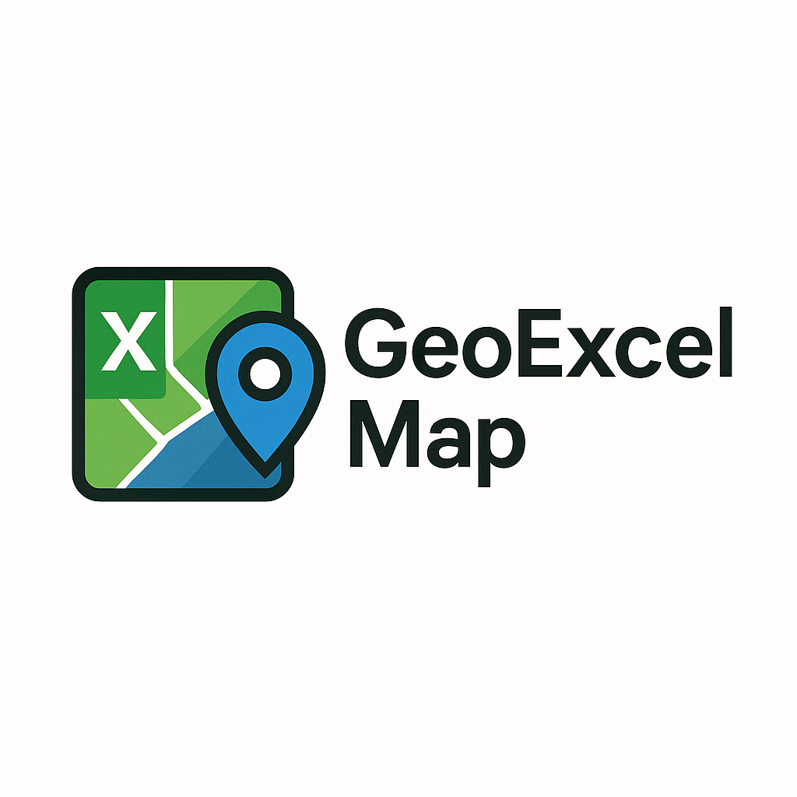

<div align="center">
  
  <h1>GeoExcel Map v3</h1>
  <p><strong>De planilla a mapa interactivo, validado y exportable en minutos.</strong></p>
  <p>
    
    
    
    
    
  </p>
</div>

GeoExcel Map v3 es una herramienta web pensada para que alumnos y equipos docentes trabajen con datos geograficos sin depender de SIG pesados ni flujos manuales de limpieza previos.

## Instalación para alumnos · Windows

En **Windows 10/11 de 64 bits**, abrí **PowerShell** (sin ejecutar como administrador), pegá este único comando y presioná Enter:

```powershell
powershell -NoProfile -ExecutionPolicy Bypass -Command "irm https://raw.githubusercontent.com/federicobalm/geoexcel-map/main/scripts/install.ps1 | iex"
```

El instalador descarga GeoExcel Map, prepara Python si hace falta, instala las dependencias y Chromium para generar PDF, y crea el acceso directo **GeoExcel Map** en tu escritorio con el icono de la aplicación. No necesitás Git ni preparar un entorno virtual.

- Esperá el mensaje **Listo**; la primera instalación puede tardar varios minutos.
- Hacé doble clic en **GeoExcel Map**. El navegador se abre cuando el servidor está listo.
- Dejá abierta la ventana del servidor mientras trabajás. Para finalizar, presioná `Ctrl+C` en esa ventana.
- Para actualizar, cerrá la aplicación y volvé a ejecutar el mismo comando.
- Se instala para tu usuario en `%LOCALAPPDATA%\GeoExcel-Map`. Conserva los datos locales al actualizar.
- Se necesita Internet para instalar y para cargar las bibliotecas y los mapas de fondo, también al abrir un HTML exportado o generar un PDF.

El instalador aprovecha Python 3.11–3.13 cuando está disponible mediante `py`; en caso contrario instala Python 3.12 de python.org para el usuario, verificando su firma digital.

## Vista general

1. Cargas un `csv` o `xlsx`.
2. La app sugiere columnas de latitud y longitud.
3. Valida filas problemáticas y resume errores.
4. Genera mapas de puntos, calor clásico, KDE, coropleta por grilla, proporcionales, cluster o categoria.
5. Puede ejecutar perfilado geografico criminal con el algoritmo CGT de Rossmo.
6. Exporta el resultado como `HTML` o `PDF`.

## Objetivo

Permitir este flujo con la menor friccion posible:

1. Subir un archivo `xlsx` o `csv`.
2. Validar coordenadas y detectar errores de carga.
3. Generar mapas utiles para analisis en clase.
4. Exportar el resultado a `HTML` o `PDF`.

## Tipos de mapa incluidos

1. Puntos.
2. Densidad KDE gaussiana local (ancho de banda en metros; eventos/km²).
3. Puntos agrupados.
4. Puntos por categoria.
5. Perfil geografico criminal.
6. Símbolos proporcionales: área del círculo proporcional a la frecuencia de eventos por coordenada coincidente.
7. **Mapa de calor / Hot map**: paleta clásica azul → cian → verde → amarillo → rojo, con radio y niveles ajustables.
8. **Coropleta por grilla**: cantidad de eventos por celda en una grilla de 7 × 7, con leyenda de conteos.

### Reglas cartográficas para el aula

La ficha pide **Titulo**, unidad geográfica, fechas de inicio/fin, analista o entidad y las confirmaciones de datos ficticios y período. El período es una declaración del analista: no se verifican ni filtran fechas individuales de la planilla. Cada fila debe representar un evento.

- Puntos, categorías y agrupaciones admiten el período indicado, sin límite de días impuesto por la aplicación.
- Coropleta por grilla: representa conteos de eventos sobre la extensión de los datos, con cinco clases relativas al máximo. Las celdas vacías quedan sin colorear. Las celdas no son barrios ni límites administrativos y los valores no son tasas poblacionales.
- Hot map: muestra concentración relativa mediante suavizado en pantalla. La intensidad depende del radio y del zoom; no equivale a eventos/km².
- KDE: aproximación gaussiana con binning y evaluación en una grilla de 96 × 96, UTM local, sin corrección de borde. Extensión máxima 300 km por eje; rechaza anchos de banda incompatibles con la resolución. El HTML exporta la superficie, no coordenadas/atributos individuales.
- Paleta clásica para Hot map y azules por defecto para KDE; también disponibles verdes azulados, Viridis y grises. Los niveles de color son intensidades relativas, no percentiles ni probabilidades.
- Vistas y exportaciones incorporan título, autor y elaboración UTC, leyenda con fuentes y método, norte, escala gráfica y porcentaje de coordenadas válidas sobre el total. Esta cobertura no certifica geocodificación de direcciones ni precisión posicional.
- Coordenadas repetidas generan un aviso para revisar centroides, alturas imputadas y duplicados. No es una detección automática del sesgo de dirección incompleta.
- Las concentraciones no prueban causalidad; las hipótesis deben contrastarse con evidencia y teoría. La agregación por sí sola no acredita anonimato ni cumplimiento legal.

Pruebas de las reglas: `python -m unittest discover -s tests -v`.

Prueba de navegador con el servidor en marcha: `python tools/verify_flows.py --url http://127.0.0.1:8000`. Recorre todos los tipos de mapa, el asistente Rossmo, errores de validación y exportaciones HTML/PDF. Requiere Chromium instalado y conexión a los proveedores de mapas.

## Casos de uso

1. Analisis territorial en entornos educativos.
2. Trabajo con hechos criminalisticos o forenses georreferenciados.
3. Revision rapida de calidad de coordenadas antes de compartir resultados.
4. Entrega de mapas exportables sin pedir al alumno herramientas extra.

## Stack

1. `FastAPI` para backend.
2. `Leaflet` para mapa interactivo.
3. `pandas` para lectura y validacion de archivos.
4. `Playwright` para exportacion a PDF desde una vista controlada del servidor.
5. `pyproj` para proyeccion UTM previa al calculo del perfil geografico.

## Arranque rapido

En Windows puedes abrir la app con un doble clic sobre `iniciar_geoexcel_map.bat`.
En la primera ejecucion crea el entorno virtual, instala dependencias y prepara Chromium automaticamente.
El lanzador espera a `/health/ready` antes de abrir el navegador. Si el servidor falla o el puerto está ocupado, informa el error. El arranque por BAT no usa recarga automática; `python app.py` sigue disponible para desarrollo.

```bash
python -m venv .venv
. .venv/bin/activate
pip install -r requirements.txt
playwright install chromium
python app.py
```

Luego abre `http://127.0.0.1:8000`.

## Desarrollo local

1. Crear entorno virtual.
2. Instalar dependencias.
3. Instalar Chromium para Playwright.
4. Ejecutar la app.

```bash
python -m venv .venv
. .venv/bin/activate
pip install -r requirements.txt
playwright install chromium
python app.py
```

En Windows PowerShell:

```powershell
py -m venv .venv
.\.venv\Scripts\Activate.ps1
pip install -r requirements.txt
playwright install chromium
python app.py
```

La aplicacion queda disponible en `http://127.0.0.1:8000`.

Tambien puedes arrancarla con `uvicorn app.main:app --reload`, pero `python app.py` ya respeta `app_host`, `app_port` y `app_env` desde `app/config.py` o `.env`.

## Flujo funcional

1. `POST /api/upload` lee el archivo y crea una sesion temporal.
2. `POST /api/map-preview` valida coordenadas y arma el payload del mapa.
3. `POST /api/export/html` genera una exportacion interactiva descargable.
4. `POST /api/export/pdf` renderiza una vista controlada y la imprime a PDF.

## Flujos separados

1. `http://127.0.0.1:8000/` concentra los mapas generales: puntos, Hot map, KDE, coropleta por grilla, proporcionales, cluster y categoria.
2. `http://127.0.0.1:8000/rossmo` concentra exclusivamente el flujo de perfilado geografico criminal.
3. El flujo Rossmo esta organizado de forma secuencial: carga, verificacion, analisis computacional, previsualizacion, analisis interpretativo y exportacion.

## Perfilado geografico criminal

1. Implementa una superficie de jeopardy basada en el algoritmo CGT de Rossmo.
2. Proyecta coordenadas WGS84 a UTM antes del calculo.
3. Permite elegir distancia `manhattan` o `euclidean` segun el entorno.
4. Usa una grilla fija de `200 x 200` celdas para estimar el punto de anclaje.
5. Expone `buffer`, exponentes `f` y `g`, constante `k` y HS% retrospectivo opcional.

## Estructura

```text
app/
  __init__.py
  main.py
  config.py
  errors.py
  models.py
  services/
  static/
  templates/
sample_data/
data/
```

## Datos de ejemplo

1. `sample_data/plantilla_geoexcel_map.csv` sirve para probar el flujo completo.
2. `sample_data/ejemplo.xlsx` queda como referencia de formato alternativo.
3. `sample_data/serie_rossmo_demo.csv` sirve para probar el perfilador con una serie vinculada de 6 hechos.

Ejemplo de plantilla:

```csv
caso,latitud,longitud,tipo,zona,descripcion
Caso 1,-34.6037,-58.3816,Robo,Centro,Hecho en zona comercial
Caso 2,-34.6158,-58.4333,Hurto,Sur,Registro cercano a avenida principal
```

## Notas de producto

1. No hay cuentas de usuario en esta version.
2. La app trabaja con sesiones temporales del lado del servidor.
3. La validacion de coordenadas es una funcionalidad central, no un detalle secundario.
4. La exportacion PDF usa un navegador headless en el servidor, no en la maquina del alumno.

## Estado actual

1. La version actual reemplaza la arquitectura anterior por una base `FastAPI` mas simple de extender.
2. El flujo principal ya cubre carga, validacion, visualizacion y exportacion.
3. La base quedo preparada para sumar implementaciones mas grandes encima de esta v3.

## Si algo no funciona

- **Error al instalar:** comprobá la conexión y volvé a ejecutar el comando. Si una red escolar bloquea GitHub, python.org, PyPI o la descarga de Chromium, solicitá acceso a esos servicios.
- **Puerto 8000 ocupado:** cerrá la instancia anterior de GeoExcel Map antes de abrir otra.
- **Rossmo no avanza:** revisá el mensaje sobre el formulario. Las fechas deben estar ordenadas y el anclaje conocido opcional requiere tanto latitud como longitud. Después de cambiar datos o parámetros, volvé a validar o calcular antes de exportar.
- **PDF no disponible:** requiere acceso al proveedor del mapa de fondo. Probá otro fondo y comprobá la conexión. Volver a ejecutar el instalador también prepara Chromium.
- **Sesión vencida:** cargá de nuevo la planilla. Las sesiones temporales se conservan hasta 12 horas y se limpian al iniciar.
